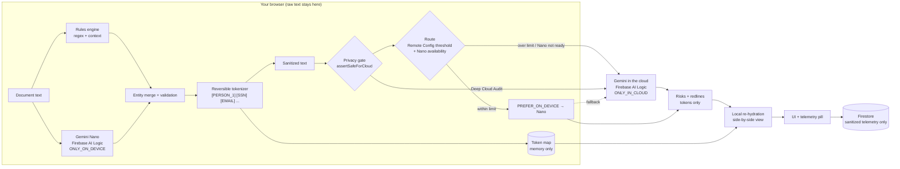

# CloakDocs: Privacy-First Hybrid AI Document Workspace

> Redact PII **on-device** with Gemini Nano. Send **only sanitized text** to Gemini in the cloud. One SDK: **Firebase AI Logic hybrid inference**.

Built for the **#BuildHybridAI 2026** hackathon. Licensed under [Apache 2.0](./LICENSE).

| | |
|---|---|
| **Live demo** | https://clockdocs.web.app |
| **Stack** | React 19 · Vite · Tailwind CSS 4 · Firebase JS SDK (`firebase/ai`, App Check, Auth, Firestore, Remote Config) |
| **Hybrid modes used** | `PREFER_ON_DEVICE`, `ONLY_ON_DEVICE`, `ONLY_IN_CLOUD` |
| **Zero secrets in the repo** | All config comes from `import.meta.env.VITE_*`; `.env` is git-ignored |

---

## 1. The problem

Recruiters, legal teams, founders and healthcare staff want to run contracts, resumes and medical or financial documents through a large cloud model. Company compliance rules (GDPR, HIPAA, SOC 2) often forbid sending raw personally identifiable information (PII) to an external server. People also work on planes, in hospitals and on VPNs, where there may be no connection at all.

## 2. The solution

CloakDocs splits the work by what each model is good at and what each data class is allowed to touch.

1. **On-device stage (Gemini Nano via Chrome's Prompt API, called through Firebase AI Logic).**
   Runs in the browser, even offline. It finds PII, replaces it with reversible tokens (`[PERSON_1]`, `[SSN]`, `[EMAIL]`, `[PHONE]`, `[SALARY]`, `[ADDRESS]`, `[DOB]`, `[ACCOUNT_n]`) and writes an instant local summary. The token → value map lives only in browser memory.
2. **Cloud deep-reasoning stage (Gemini in the cloud via Firebase AI Logic).**
   Receives only the sanitized text. Returns the top 3 legal or financial risks, severity badges, compliance and risk scores, and redline rewrites. The UI re-hydrates the tokens locally or shows a side-by-side comparison of what the cloud saw and what you see.
3. **Auto hybrid routing (`PREFER_ON_DEVICE`).**
   One call site. The SDK uses Gemini Nano when it is ready and falls back to the cloud when it is not. A Remote Config threshold routes oversized documents straight to the cloud.

### Defense in depth for privacy

| Layer | What it does |
|---|---|
| Rules engine | Deterministic regex and context rules (SSN, email, phone, card, labeled IDs, DOB, addresses, compensation amounts, title and label-anchored names). Always runs, works offline with no model. |
| Gemini Nano | Finds names and other entities the rules miss. Its output is validated: every returned string must literally occur in the document, so hallucinated entities are dropped. |
| `ONLY_ON_DEVICE` for raw text | Raw text is only ever given to a model created with `ONLY_ON_DEVICE`. The code also checks `inferenceSource` and aborts if the SDK ever reports cloud inference for raw text. |
| **Privacy gate** | Before any cloud-bound call, `assertSafeForCloud()` re-scans the outbound text for every known original value and for structured identifiers. Any hit blocks the request. |
| Network payload inspector | The audit panel shows the exact characters that left the device (or "nothing left this device" when Nano answered). |
| Firestore rules | History stores only latency, target, scores and entity **counts**. `firestore.rules` rejects any other field. |

---

## 3. How Firebase AI Logic hybrid inference is used

`src/firebase.js` creates the service:

```js
import { getAI, GoogleAIBackend } from 'firebase/ai';
const ai = getAI(app, { backend: new GoogleAIBackend() });
```

`src/hybridService.js` creates one `GenerativeModel` per task with `getGenerativeModel(ai, { mode, onDeviceParams, inCloudParams })`:

| UI action | Inference mode | What is sent | Behavior |
|---|---|---|---|
| **Local PII Redact & Triage** | `InferenceMode.ONLY_ON_DEVICE` | Raw text, to Gemini Nano only | Runs offline. If Nano is unavailable or still downloading, the rules engine finishes the job locally (shown as amber **HYBRID FALLBACK**). Raw text is never routed to the cloud. |
| **Deep Cloud Clause Audit** | `InferenceMode.ONLY_IN_CLOUD` | Sanitized text only (after the privacy gate) | Structured JSON via `responseSchema`: top 3 risks, severity, redlines, scores. |
| **Auto Hybrid Route** | `InferenceMode.PREFER_ON_DEVICE` (or `ONLY_IN_CLOUD` over the threshold) | Sanitized text only | Nano answers when ready (green). Otherwise the SDK falls back to the cloud (amber). |

The header pill reports where each run really executed, using `response.inferenceSource` (`ON_DEVICE` or `IN_CLOUD`):

- 🟢 **ON-DEVICE (Gemini Nano 4)**: answered by the on-device model.
- 🔵 **CLOUD (Firebase AI Logic)**: answered by the cloud model.
- 🟠 **HYBRID FALLBACK**: the hybrid router used the cloud (device not ready or over threshold), or the rules engine finished the on-device stage.

It also shows exact round-trip latency in ms and a live **Online / Offline** indicator (`navigator.onLine` listeners).

Device handling follows the Firebase docs: `initializeDeviceModel()` is called from a user gesture, the **Prepare Gemini Nano** button shows download progress, and a pending download is never awaited on the redaction path, so the UI never hangs.

### Supporting Firebase services

| Service | Use |
|---|---|
| **App Check** (`initializeAppCheck`) | Required by Firebase AI Logic. `self.FIREBASE_APPCHECK_DEBUG_TOKEN` is set from `VITE_APPCHECK_DEBUG_TOKEN` before initialization so judges can test with a debug token. Falls back to reCAPTCHA v3 or Enterprise when a site key is provided. |
| **Authentication** | `signInAnonymously` on load. Zero login friction. The anonymous user persists, so history also works offline after the first visit. |
| **Cloud Firestore** | `users/{uid}/audits`: sanitized audit runs, latency telemetry and risk scores. Persistent local cache; a real-time `onSnapshot` listener drives the history drawer. |
| **Remote Config** | `max_local_char_limit` (default `6000`), `enable_cloud_deep_audit` (default `true`), `cloud_model` (default `gemini-3.5-flash-lite`). Local defaults are used when offline. |

---

## 4. Architecture



```
 raw text ─► rules + Gemini Nano (ONLY_ON_DEVICE) ─► tokens + sanitized text
                                                          │  (privacy gate)
                         ┌────────────────────────────────┴───────────────┐
                         ▼                                                ▼
          ONLY_IN_CLOUD  (Gemini, deep audit)        PREFER_ON_DEVICE (Nano → cloud fallback)
                         └──────────────► risks / redlines (tokens) ◄─────┘
                                                  │
                                      local re-hydration (browser only)
```

### Project layout

```
.
├── LICENSE                 Apache License 2.0
├── README.md
├── .env.example            Template for all VITE_* variables (no secrets)
├── .gitignore              .env, .env.local, node_modules/, dist/ ...
├── package.json
├── vite.config.js
├── index.html
├── firebase.json           Hosting (SPA → dist/) + Firestore rules
├── .firebaserc             Project alias template
├── firestore.rules         Per-user, field-restricted, create/read/delete only
├── public/
│   ├── favicon.svg
│   ├── manifest.json       Optional MV3 Chrome extension manifest (side panel)
│   └── background.js       Opens the side panel on toolbar click
└── src/
    ├── firebase.js         App, App Check, Auth, Firestore, Remote Config, AI Logic init
    ├── hybridService.js    Redaction engine, re-hydration, privacy gate, cloud auditor, router, telemetry
    ├── auditStore.js       Firestore history (write / live listener / clear)
    ├── samples.js          Three one-click demo documents (all data is fictional)
    ├── App.jsx             UI
    ├── main.jsx
    └── index.css
```

---

## 5. Local setup

**Requirements:** Node.js 20+, a Firebase project, and desktop **Chrome 139+** for on-device inference. Other browsers still work through the rules engine and cloud fallback.

### 5.1 Create the Firebase project

1. In the [Firebase console](https://console.firebase.google.com/), create a project and add a **Web app**.
2. **AI Logic**: open *Build → AI Logic → Get started* and choose the **Gemini Developer API**.
3. **Authentication**: *Build → Authentication → Sign-in method* → enable **Anonymous**.
4. **Firestore**: *Build → Firestore Database* → create a database (production mode; the rules in this repo are deployed below).
5. **Remote Config** (optional): add parameters `max_local_char_limit` (Number), `enable_cloud_deep_audit` (Boolean), `cloud_model` (String), then **Publish**.
6. **App Check**: *Build → App Check → Apps* → register the web app. Firebase AI Logic requires App Check enforcement.

> Repo helpers: `remoteconfig.template.json` holds the three Remote Config parameters and `firebase.json` enables Anonymous auth (`auth.providers.anonymous`), so `firebase deploy --only auth,remoteconfig,firestore:rules,hosting` reproduces this setup. Firebase AI Logic is turned on with the Gemini Developer API in the console (or the `ailogic` CLI commands behind `FIREBASE_CLI_EXPERIMENTS=ailogic`).

### 5.2 Configure the app

```bash
git clone https://github.com/yashpy/CloakDocs.git
cd CloakDocs
cp .env.example .env
# fill in the Firebase web config values from Project settings → Your apps
npm install
npm run dev
```

**App Check debug token (for judges and local testing):**

1. Set `VITE_APPCHECK_DEBUG_TOKEN=true` in `.env` and start the app.
2. Open DevTools → Console and copy the line `Firebase App Check debug token: "…"`.
3. In the console go to *App Check → Apps → your web app → ⋮ → Manage debug tokens* and register it.
4. Paste the same value into `VITE_APPCHECK_DEBUG_TOKEN` (or keep `true` and re-register when it changes).

> Never commit a debug token and never deploy a build that contains one. For production, set `VITE_RECAPTCHA_SITE_KEY` and `VITE_RECAPTCHA_PROVIDER` (`v3` or `enterprise`) and leave the debug token empty.

### 5.3 Enable Gemini Nano in Chrome

1. Update Chrome (**139 or newer**, desktop).
2. Open `chrome://flags/#prompt-api-for-gemini-nano` → **Enabled**.
3. Open `chrome://flags/#optimization-guide-on-device-model` → **Enabled BypassPerfRequirement** (needed on machines that don't meet the default hardware check).
4. Depending on your Chrome version you may also need `chrome://flags/#prompt-api-for-gemini-nano-multimodal-input` → **Enabled**.
5. **Relaunch** Chrome.
6. Open the app and check the header chip:
   - *Gemini Nano ready*: you are set.
   - *download needed*: click **Prepare Gemini Nano**. The download takes several minutes and needs free disk space.
7. To verify from DevTools: `await LanguageModel.availability()` should return `available`.

> The first on-device download must be started by a user gesture (the button does that).

### 5.4 Demo script (under 3 minutes)

1. Click **Employment Agreement**, then **Local PII Redact & Triage**. The pill turns **green: ON-DEVICE** with latency in ms.
2. DevTools → Network → **Offline** (or airplane mode). The badge flips to **Offline** immediately. Run **Local PII Redact** again: still green and still working.
3. Go back online and click **Deep Cloud Clause Audit**. The pill turns **blue: CLOUD**. Open the **Network payload inspector** to show only tokens left the device.
4. Switch the result view to **Side by side** to show what the cloud saw next to the locally re-hydrated text.
5. Click **Auto Hybrid Route** on a short document (stays on-device) and on a long one (routes to the cloud, **amber: HYBRID FALLBACK**).
6. Open **History** to show live Firestore telemetry.

---

## 6. Deploy to Firebase Hosting

```bash
npm install -g firebase-tools
firebase login
# edit .firebaserc and replace "your-firebase-project-id" (or: firebase use --add)
npm run build
firebase deploy --only hosting,firestore:rules
```

`npm run deploy` runs the build and the same deploy command. After deploying, add your Hosting domain to App Check (register a reCAPTCHA provider) so real users can use AI Logic with enforcement on.

---

## 7. Optional: Chrome extension

`public/manifest.json` is a Manifest V3 extension that opens CloakDocs in the browser **side panel**.

```bash
npm run build
# chrome://extensions → Developer mode → Load unpacked → select the dist/ folder
```

Notes: the extension uses the App Check **debug token** flow (reCAPTCHA cannot load remote scripts inside extension pages), so build it with `VITE_APPCHECK_DEBUG_TOKEN` set and keep that build private. This part is experimental.

---

## 8. Security and privacy notes

- No credentials are committed. `.env`, `.env.local`, `node_modules/` and `dist/` are git-ignored. Firebase web config values are not secrets, but they are kept out of the repo anyway.
- Firestore rules allow a user to read, create and delete only `users/{their uid}/audits/*`, reject unknown fields, and forbid updates.
- Detection is best-effort. Rules and an on-device model can miss unusual identifiers. Review the sanitized text and the token map before sending anything to the cloud; the sanitized text is always shown before the cloud audit.
- Output is triage assistance, **not legal or medical advice**.
- All sample data is fictional (invalid SSN ranges, `555` phone numbers, `example.*` domains).

## 9. Verification status

- `npm install && npm run build` completes cleanly.
- The redaction engine was run against all three sample documents: no original value remains in the sanitized text, and the privacy gate blocks text containing an SSN or phone number.
- The full UI flow was exercised in headless Chromium with a **mocked** `LanguageModel` (Gemini Nano) and stubbed Firebase endpoints: on-device run, cloud run (request body contained no PII, only tokens), the threshold route to cloud, the Nano-unavailable fallback, and offline operation.
- It has **not** been run against a real Gemini Nano download or a live Firebase project in CI. Do a final end-to-end pass with your own project and Chrome before recording the demo.

## 10. License

Copyright 2026 CloakDocs contributors. Licensed under the [Apache License, Version 2.0](./LICENSE).
